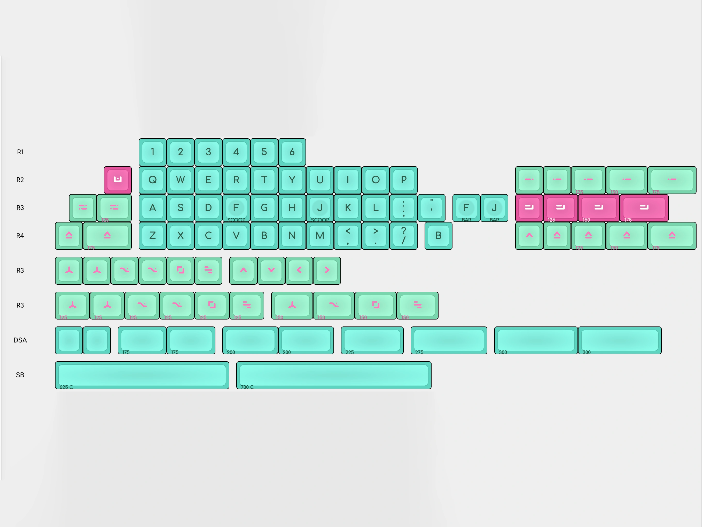

# DSS 99¢

DSS 99¢ is a keycap set designed by Sidrow. 

## Specifications

|Key|Value
|---|---
Designer|Sidrow
[Manufacturer](/en/keycaps/manufacturers)|[Signature Plastics](/en/keycaps/manufacturers/signature-plastics)
[Profile](/en/keycaps/profiles)|[DSS](/en/keycaps/profiles/dss) + [DSA](/en/keycaps/profiles/dsa) Mini-bars
Legends|Doubleshot
Material|ABS

### Color Codes

The colors are Signature Plastics' stock color samples.

Color|Code
|---|---
Alpha Legends|**VDR**
Alpha Keys|**VBV**
Mod Legends|**RFJ**
Mod Keys|**VCO**
Accent Legends|**WA**
Accent Keys|**RFJ**

<!-- NOTE: The VBV, VCO, and WA hex colors were measured from SP color chips. -->
<!-- The VDR and RFJ hex colors were sampled from the kitting render, not measured like the others. -->

## Kits

- all-in-one kit 

