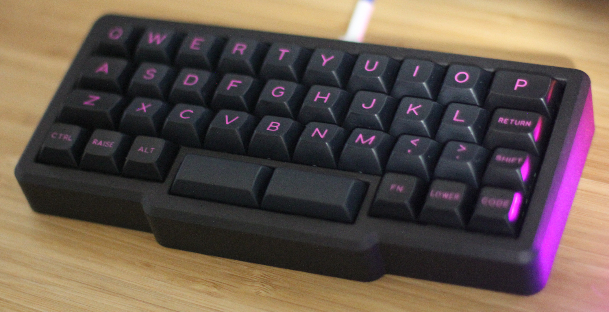
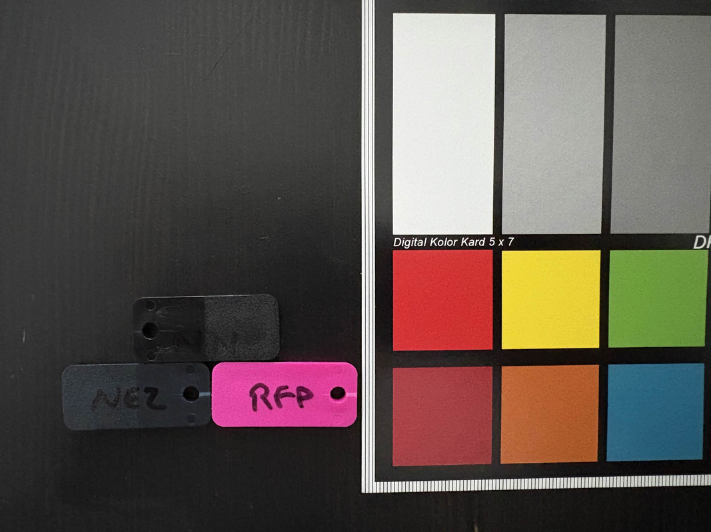

# DSS Distortion

DSS Distortion is a keycaps set deisgned by madmax13. "This set features vibrant pink legends and accents inspired by the aesthetics of early punk rock albums."[^1]

The design went through several iterations starting in late 2024.
Multiple keycap profiles were explored including SA, CYL, and eventually DSS in mid 2025.

## Specifications

|Key|Value
|---|---
Designer| madmax13
Manufacturer| Signature Plastics
Profile| DSS + DSA bottom row
Legends| Doubleshot
Material| ABS

### Color Codes

The colors are Signature Plastics' stock color samples.

Color|Code
|---|---
Alphas|**NEZ**
Mods|**NN**
Pink|**RFP**
<!-- NOTE: The NEZ and RFP hex colors were eyeballed, not measured like the NN color was. -->

## Kits

40s Monokit

CutiePie Extension kit

Colmak

## References

[^1]: geekhack (2026) https://geekhack.org/index.php?topic=126526