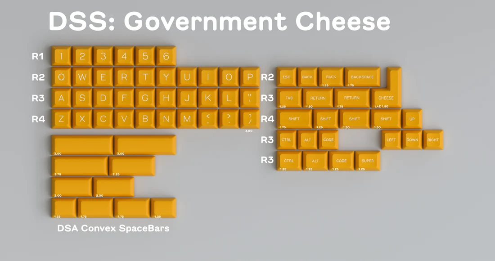

# DSS Government Cheese

DSS Government Cheese is a keycap set designed by Swear_Wolf. 

## Specifications

|Key|Value
|---|---
[Designer](/en/designers)|[Swear_Wolf](/en/designers/swear-wolf)
[Manufacturer](/en/keycaps/manufacturers)|[Signature Plastics](/en/keycaps/manufacturers/signature-plastics)
[Profile](/en/keycaps/profiles)|[DSS](/en/keycaps/profiles/dss)
Legends|Doubleshot
Material|ABS

### Color Codes

The colors are Signature Plastics' stock color samples.

Color|Code
|---|---
Yellow|**YCG**
White|**WA**
<!-- NOTE: The WA hex colors was measured from a SP color chip. -->
<!-- The YCG hex color was sampled from the kitting render, not measured. -->

## Kits

- 40s Monokit

