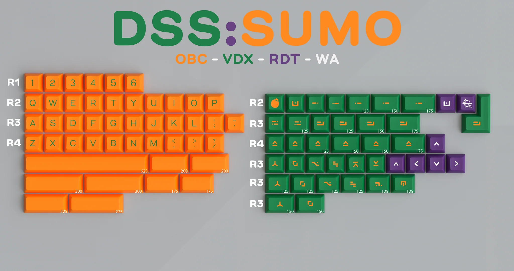

# DSS Sumo

"DSS Sumo is a citrus inspired keyset based on the gigantic Sumo oranges everyone knows and loves from their favorite grocery store! Featuring vibrant orange, with purple and green accets (representative of the stickers you see on the fruit) this set is sure to bring a vibrant aura to your setup!"[^1]

## Specifications

|Key|Value
|---|---
[Designer](/en/designers)|[Swear_Wolf](/en/designers/swear-wolf)*
[Manufacturer](/en/keycaps/manufacturers)|[Signature Plastics](/en/keycaps/manufacturers/signature-plastics)
[Profile](/en/keycaps/profiles)|[DSS](/en/keycaps/profiles/dss)
Legends|Doubleshot
Material|ABS

*Sumo novelty by [Deadeye](https://switchbox.studio/)

### Color Codes

The colors are Signature Plastics' stock color samples.

Color|Code
|---|---
Orange|**OBC**
Green|**VDX**
Purple|**RDT**
White|**WA**
<!-- NOTE: The OBC and WA hex colors were measured from SP color chips. -->
<!-- The VDX and RDT hex colors were sampled from the kitting render, not measured like the others. -->

## Kits

- 40s Monokit

## References

[^1]: Saberkeebs (2026) https://saberkeebs.com/products/group-buy-dss-sumo