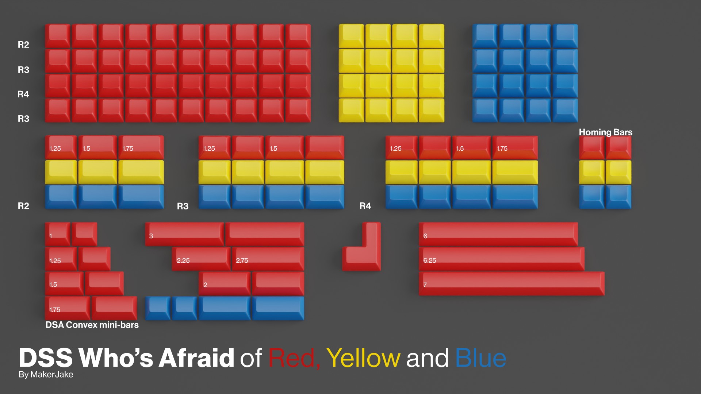

# DSS Who's Afraid

DSS Who's Afraid is a keycap set designed by MakerJake.

"Who's Afraid of Red, Yellow, and Blue is a series of paintings by American painter Barnett Newman.
[MakerJake is] a really big fan of Newman's work, and this series is no different.
The goal [of this keycap set] is to enable anyone to create each painting using their keyboard as the canvas."[^1]

## Specifications

|Key|Value
|---|---
[Designer](/en/designers)|MakerJake
[Manufacturer](/en/keycaps/manufacturers)|[Signature Plastics](/en/keycaps/manufacturers/signature-plastics)
[Profile](/en/keycaps/profiles)|[DSS](/en/keycaps/profiles/dss) + [DSA](/en/keycaps/profiles/dss) Convex mini-bars
Legends|Blank
Material|ABS

### Color Codes

Pantone color swatches were explored when the keyset was going to be produced in the [PBS](/en/keycaps/profiles/pbs) profile.
**P 48-16 C**, **P 7-8 C**, **P 105-8 C** However, the colors used for production are Signature Plastics' stock color samples.

Color|Code
|---|---
Red|**RA**
Yellow|**YCH**
Blue|**BFK**

## Kits

- 40s Monokit

## References

[^1]: geekhack (2026) https://geekhack.org/index.php?topic=125475